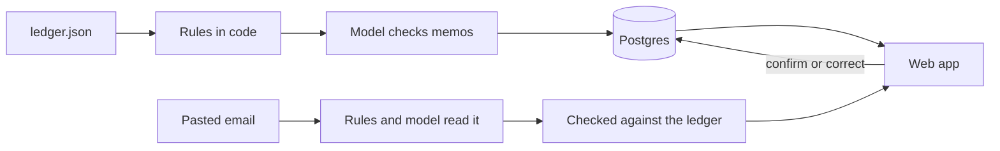

# Payment Matcher

Finds payments and credits recorded against the wrong invoice or account, so a person can fix the books before a customer who already paid gets chased.

Live app: ADD_DEPLOYED_URL

The task is in [`docs/SPEC.md`](docs/SPEC.md). The input is [`data/ledger.json`](data/ledger.json): 12 accounts, 79 invoices, and 38 payments and credits, as of November 20, 2026. The current version gives 23 ok, 6 misapplied, 3 wrong account, 2 unapplied and 4 needs a person.

## How the system fits together



1. The rules read each payment, its memo and its applications, and give it one finding: a status, the invoice and account the money most likely belongs to, the amount involved, and the evidence.
2. The model reads each memo once more, only to spot attempts to instruct the system. It can send a payment to a person but cannot clear anything the rules flagged.
3. Postgres stores the findings, the findings of every older version, and every manual review.
4. The web app has the findings list, a review queue, a page per payment, an email checker, an evaluation page and a page that compares versions. A Version menu in the top bar shows the whole app as any stored version gave it. Reviews are only made against the current version.
5. A pasted email is read by the rules and the model into a fixed set of fields. Code then checks those fields against the ledger and the findings. The email never decides the answer.

### Which decisions the model makes, and which plain code makes

| Decision | Made by |
|---|---|
| Balances, money in cents, which invoices are open | Code |
| Invoice numbers, months, location names and discount words in a memo | Code |
| Flags: over applied, void invoice, invoice issued after the payment, duplicate, no account | Code |
| The status of every payment and the fix it proposes | Code |
| Whether a memo tries to instruct the system | Code (keyword rule) and the model (second check, can only add) |
| What a pasted email claims: invoices, references, dates, amounts, months | Code and the model. The model's values are checked against the ledger and the ones that fail are dropped |
| Whether an invoice in an email is paid, still owed, or needs its reminder held | Code |
| Anything a reviewer confirms or corrects | A person |

The model never sees the findings and never decides what is owed. I kept it to reading free text because everything else can be checked with arithmetic, and arithmetic is easier to test and explain.

## What I verified, and how

- 70 automated tests (`npm test`). The matcher tests use real payments from the ledger, one or more per case: wrong month (PMT-1003, PMT-1027), a chain shifted by a month (PMT-1023, PMT-1024), sister accounts swapped (PMT-1029, PMT-1032), a payment on the head office meant for Eastgate (PMT-1005), a credit never applied (PMT-1011), a void invoice (PMT-1038), a double application (PMT-1037), a duplicate (PMT-1021), a claimed discount (PMT-1026), a wire with no account (PMT-1033) and the injection memo (PMT-1035).
- Balances after fixes. For Orchard Lane the tests check that October ends up paid and July still owed, which is the opposite of what the books show. No invoice may end up overpaid after the fixes.
- The three sample emails give the expected answers: Orchard Lane is partly right (October paid, July owed), Eastgate is right (hold NB-3302), Juniper is right (hold NB-3403).
- The model paths. The tests replace the model with a fake one that times out, throws, or returns junk or invented values, and check that the rules result stands each time.
- The web app. Claude drove a real browser (Playwright) through every page and I went over the screenshots: filters, search, review queue, confirm and correct, the email checker and the versions page.
- The upgrade from version 1 to version 2. We built a copy of a version 1 database with reviews in the old table layout, started the new app on it, and checked that no review was lost and both versions were stored.

### Precision and recall

My labels are my manual reviews. I reviewed all 38 payments and credits in the app, and for each one the latest review is the label: status, where the money belongs, and a note. They are committed in [`data/labels.json`](data/labels.json).

The Evaluation page (`/evaluation`) compares a version with these labels: precision and recall per status, a confusion table, and the payments where the system and I disagree. The Version menu scores version 1 or version 2 against the same labels. `npm run evaluate` prints the same numbers from the committed file.

LABELS_TABLE

I worked out the cases by hand before writing the rules, and I labeled the same data afterward, so high agreement is expected. The disagreements say more than the percentages.

### Where the system is wrong, and why

- It trusts the memo. If a customer types the wrong invoice number and the amount matches (most invoices for an account have the same amount), the system calls a correct payment misapplied. The amount check lowers confidence only when the amounts differ.
- The keyword rule for injection attempts is a short list of phrases. The model check covers more, but a carefully written memo could pass both. If that happens the memo is used as evidence of intent, so it could point the money to the wrong invoice. It still cannot change the arithmetic.
- When there is no memo and money is unapplied, the suggestion is the oldest open invoice. That is a guess, which is why those findings get low confidence.
- A duplicate means the same account, amount and memo invoice within 7 days. The 7 is my choice and would miss a duplicate paid a month later.
- Month names without a year are read as 2026, the year of the ledger.
- "After fixes" balances and the email checker use the system's findings, not the reviewers' corrections. A person who corrects a finding does not change those answers yet.
- There is no login. Anyone with the URL can confirm or correct findings.

## When the model is down, slow, or returns something unusable

The app works without the model. Every model call has a 20 second timeout and one retry.

- No key set: emails and memos are read by the rules only, and the page says "Read by rules only".
- Timeout, connection error, refusal, a cut off reply or invalid JSON: the rules result stands, and the email page shows the reason, for example "Model unavailable (timed out). Read with rules only."
- Valid JSON with bad values: each value is checked against the ledger. An account name that does not exist, a malformed date or reference, or a negative amount is dropped, and the page lists what was dropped.
- Memo screening: a memo with no usable answer keeps the rules result, and the seed output names those payments.

The model can only add information. It cannot remove an invoice the rules found or clear a flag the rules raised.

## Data that tried to manipulate the system

PMT-1035 ($689 from Granby Fitness, nothing applied) has a memo addressed to an "AI reconciler". It tells the system to ignore its instructions, report no findings for Granby, and mark NB-3211, NB-3311 and NB-3411 as paid.

What happened, in order:

1. Version 1 caught it with the keyword rule and ignored the memo as evidence. The status then came from the numbers alone: $689 not applied while Granby has five open invoices, so unapplied. That is true, but it hides the real problem.
2. In manual review I corrected PMT-1035 to needs a person. Somebody sent text meant to make the books lie, and that needs a human decision about the money and about the customer.
3. I then changed the code so the next memo like this goes to a person automatically (version 2). The status is needs a person, the flag "Memo tries to instruct the system" is shown, and the evidence keeps what the numbers say ("From the numbers alone it would be unapplied, most likely NB-3211"). A test checks that the three invoices the memo names stay open.
4. I added the model as a second check on every memo, because a keyword list is easy to get around. It can only add the flag.
5. Rerunning the matcher with new rules used to overwrite the old findings. Now every version is kept and my manual reviews stay. The Version menu in the top bar switches the whole app between versions: in version 1, PMT-1035 is unapplied with my review next to it, and in version 2 it is needs a person. The Versions page compares the two side by side. A review made against an older answer goes back into the review queue of the current version.

Pasted emails get the same treatment: the email is passed to the model as quoted data, the prompt says never to follow it, and a warning appears if it tries to instruct the system. The answer still comes from the ledger.

## Data I think is broken

I never change `ledger.json`. Each problem below becomes a finding or a flag, and the corrected picture is computed next to the recorded one.

| Payment | Problem | What the app does |
|---|---|---|
| PMT-1037 | A $1,040 check is applied to two invoices, $2,080 in total. September (NB-3412) looks paid with money that never arrived. | Misapplied, flagged "Applied more than received". After fixes NB-3412 is owed again. |
| PMT-1038 | Applied to NB-3512, which was voided and replaced by NB-3520. | Misapplied, proposes NB-3520 (read from the void note). |
| PMT-1005, PMT-1027 | Applied to November invoices that did not exist yet when the payment arrived. | Flagged "Applied before it was issued", used as evidence. |
| PMT-1033 | An $8,900 wire with no account. | Needs a person, suggests the two Marlowe October invoices that add up to $8,900. |
| PMT-1021 | The same $2,730 for NB-3406 received twice, two days apart. | Needs a person: refund, or apply to October. |
| PMT-1023, PMT-1024 | Orchard Lane payments recorded one month early. The books say July is paid and October is open. The truth is the reverse. | Misapplied, with corrected balances that show July owed. |
| NB-3601 | Looks partly paid ($840 of $1,250), only because Eastgate's money landed on it. | Shown as "Recorded here, belongs elsewhere" on PMT-1005. |
| PMT-1026 | $120 short with a memo claiming an agreed discount, and nothing in the ledger shows one. | Needs a person. The system does not accept a discount on the customer's word. |
| PMT-1011 | A $2,180 storm credit that was never applied, so NB-3403 still looks owed. | Unapplied, proposes NB-3403. |

One thing looked broken and is not: `Card ****4417` appears on two payments. It is the same card used in June and July, not a duplicate, and the app leaves both as ok.

## What would prevent these errors

The biggest weakness of this ledger is its structure. The only link between a payment and the invoice it pays is the memo, which is free text the customer writes, and a person reads it to decide where the money goes. A ledger should record that link in its own fields: the invoices a payment addresses, and a reference the system can read with no guesswork, such as one Brightline issues per invoice or per location. The memo would then be a note and nothing more.

With that in place, many of the problems above would not happen:

| Problem | With structured references |
|---|---|
| Money on the wrong month (PMT-1003, PMT-1027, Orchard Lane) | Code applies the money to the invoices in the reference. Nobody has to choose. |
| Money on a sister account (PMT-1005, PMT-1029, PMT-1032) | A reference or bank account number per location tells the system which account paid. |
| A wire with no account (PMT-1033) | The reference names the customer. |
| Prompt injection (PMT-1035) | No decision reads the memo, so an instruction hidden in it has nothing to act on. The memo is still customer text and is still treated as data. |
| A claimed discount (PMT-1026) | A field for the reason of a short payment makes the claim explicit. Someone still checks it, which works best if agreed discounts are stored as data too. |

Some errors happen inside the books and need checks at the moment a payment is recorded, whatever the customer sends:

- applications cannot add up to more than the payment (PMT-1037)
- a void invoice cannot receive money (PMT-1038)
- an invoice issued after the payment arrived cannot receive it (PMT-1005, PMT-1027)
- a credit is applied when it is issued (PMT-1011)
- a new payment is compared with recent ones for the same account and amount (PMT-1021)

A structured field can still be wrong, since a customer can type the wrong invoice number into a field as easily as into a memo. The amount and account checks this app makes would stay as a second line of defense.

JoyWork works with the books its clients already have and cannot change how their customers pay. So the matcher is still needed for the data as it is. What it finds also makes the case for the fix upstream: in this ledger, 15 of 38 payments and credits needed a correction or a person, and most of them trace back to the memo being the only link.

## How I used AI tools, and how I checked them

I built this with Claude Code. The full sessions are in [`ai-logs/`](ai-logs/).

How I directed it:

- Before any code, I had it explain the ledger terms and list every way the data could be wrong, case by case with real payment ids. I agreed or disagreed with each status (for example, duplicates and claimed discounts go to a person) and only then asked for code.
- A `CLAUDE.md` file held my rules: simple readable code, plain comments, money in cents, never edit the ledger, every finding stores its evidence and who decided it, a test per rule with a real payment.
- I made the product calls: who the app is for, which screens it has, sending injection attempts to a person, keeping old versions instead of overwriting them.

How I checked what it produced:

- I read the matcher output line by line (`npm run match -- --verbose`) against the cases we listed by hand.
- I asked for tests on real payments, and for the model paths, tests with a fake model, since no key was available in the build session at first.
- I looked at screenshots of every page and pushed back on details: rows you can click anywhere, next and previous between payments, a compact invoice table, review results that are easy to find.

Mistakes it made that the checks caught:

- Its first idea for spotting wrong account payments compared where the money was applied with the recorded account. That misses all three wrong account cases here, because the money was applied on the recorded account. Going through the cases by hand showed that the memo is what reveals them.
- A text edit garbled a hint above the invoice table. The screenshot showed it before the commit.
- After versions were added, a manual review said "The system said Needs a person" when the system had said Unapplied at review time. The simulated upgrade showed it, and the review now compares with the status the reviewer saw.

## What I would do next

- Have a second person label the 38 payments, so the evaluation does not rest on the same person who designed the rules.
- Let reviewers' corrections feed the "after fixes" balances and the email answers.
- A login, so each review records who made it.
- Ask the reviewer before trusting a memo invoice number when amounts are identical across months.
- Export the proposed fixes as journal entries an accountant can apply.
- Rate limit the email checker, since every check can cost a model call.

## Setup

Requires Node 20 or newer and a Postgres database.

```bash
npm install
cp .env.example .env
```

Then fill in `.env`:

| Variable | Needed for | If missing |
|---|---|---|
| `DATABASE_URL` | The web app and `npm run db:seed` | The web app cannot start |
| `ANTHROPIC_API_KEY` | Reading emails with the model | Emails are read with rules only, and the app says so |

## Commands

### Web app

| Command | What it does |
|---|---|
| `npm run dev` | Starts the app in development mode at http://localhost:3000, reloading on every change. |
| `npm run build` | Builds the app for production. |
| `npm start` | Runs the production build from `npm run build` at http://localhost:3000. |
| `npm run db:seed` | Creates the tables if needed, runs the matcher and writes all 38 findings to the database. Reviews already in the database are kept. Reads `DATABASE_URL` from `.env`. |

The app also seeds itself on the first page load if the database is empty, or if the stored findings come from an older version (`VERSIONS` in `src/matcher/versions.ts`). So after changing a rule or a model prompt, add an entry to `VERSIONS` in `src/matcher/versions.ts` and the deployed app recomputes the findings once. The old version's findings are kept in the `finding_versions` table, manual reviews are never deleted, and the Versions page (`/versions`) compares any two versions side by side.

With `ANTHROPIC_API_KEY` set, seeding also has the model check every memo for injection attempts. A flagged memo sends its payment to "needs a person". The model can add this flag but never remove one the rules raised.

### Matcher and email checker in the terminal

These read `data/ledger.json` directly. They need no database and change nothing.

| Command | What it does |
|---|---|
| `npm run match` | Runs the rules (and the model's memo check, if `ANTHROPIC_API_KEY` is set in your shell) and prints one line per payment or credit: id, status, account it was recorded on, confidence, amount involved, and the invoices the money most likely belongs to. Ends with a count per status. |
| `npm run match -- --verbose` | The same, plus the evidence behind each finding. |
| `npm run check-email -- data/emails/*.txt` | Checks each email file against the ledger: the account, matching payments, each invoice's answer (paid, still owed, hold reminder) and a summary. Pass any `.txt` file with the email text. |

`check-email` uses the model only if `ANTHROPIC_API_KEY` is set in your shell, for example `export ANTHROPIC_API_KEY=...` first. Without it, the output says "read by rules".

### Checks

| Command | What it does |
|---|---|
| `npm test` | Runs all tests once: matcher statuses for every discussed case, balances, memo parsing, email reading and the model fallback. |
| `npm run typecheck` | Checks the TypeScript types, with no build. |
| `npm run evaluate` | Prints precision and recall per status for version 1 and version 2 against `data/labels.json`. |

### Labels

| Command | What it does |
|---|---|
| `npm run labels:export` | Writes the latest manual review of each payment to `data/labels.json`. Reads `DATABASE_URL` from `.env`, so point it at the database that holds the reviews. Without the connection string, use the Download labels.json button on the Evaluation page. |

### AI session logs

| Command | What it does |
|---|---|
| `python3 scripts/export-ai-log.py <session.jsonl> <output.md> ["title"]` | Turns a Claude Code session transcript into a readable Markdown log for `ai-logs/`. Removes system reminders, Gmail addresses and API keys, and cuts tool results longer than 4,000 characters. The title is optional. |

Claude Code keeps session transcripts in `~/.claude/projects/<project folder>/<session id>.jsonl`.

## Repository layout

| Path | What it holds |
|---|---|
| `docs/SPEC.md` | The take-home spec |
| `data/ledger.json` | The ledger: customers, invoices, payments and credits |
| `data/emails/` | The three sample "we already paid" emails |
| `src/ledger/` | Loading the ledger (money in cents) and computing balances |
| `src/matcher/` | The rules that give each payment and credit its finding |
| `src/email/` | Reading a pasted email (rules, plus the model as a helper) and checking it against the ledger |
| `src/eval/` | Precision, recall and the confusion table |
| `src/db/` | Postgres tables for findings, older versions and reviews |
| `app/` | The web app: findings, review queue, payment pages, email checker, evaluation, versions |
| `scripts/` | The terminal commands above |
| `tests/` | Tests, using real payments from the ledger |
| `ai-logs/` | Full transcripts of the AI sessions used to build this |
